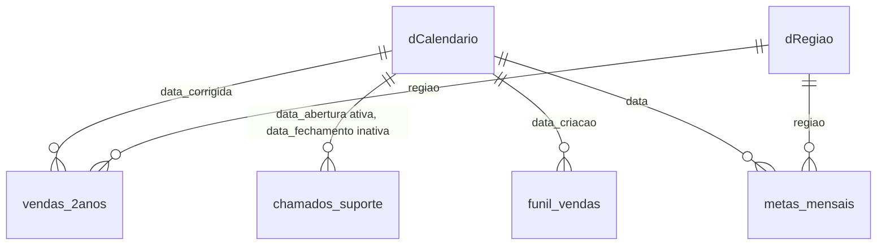

# Dashboard Comercial e Operacional | Power BI

Projeto de estudo ponta a ponta em Power BI. A partir de quatro extrações brutas (vendas, funil comercial, chamados de suporte e metas), tratei os dados no Power Query, montei um modelo em estrela, criei as medidas em DAX e construí um dashboard com 3 páginas principais e 2 páginas de detalhamento, incluindo drill-through.

> ⚠️ \*\*Os dados são sintéticos\*\*, gerados via Inteligência Artificial (Claude, da Anthropic) exclusivamente para fins de estudo e simulação de cenários reais. Nenhum número representa uma empresa existente.

!\[Página Executiva](imagens/01-executiva.png)

!\[Navegação pelas páginas principais](imagens/demo-paginas.gif)

## Sumário

1. [Contexto e objetivo](#1-contexto-e-objetivo)
2. [Dados](#2-dados)
3. [Passo a passo](#3-passo-a-passo)
4. [Principais leituras](#4-principais-leituras)
5. [Desafios e aprendizados](#5-desafios-e-aprendizados)
6. [Limitações e próximos passos](#6-limitações-e-próximos-passos)
7. [Como abrir o projeto](#7-como-abrir-o-projeto)
8. [Estrutura do repositório](#8-estrutura-do-repositório)

\---

## 1\. Contexto e objetivo

Simulei a demanda de uma diretoria que precisava de um painel único para a reunião de performance, juntando visões do comercial, do suporte e do financeiro. O pedido tinha sete frentes:

|#|Pedido|Onde está no dashboard|
|-|-|-|
|1|Comparativo ano a ano (YoY)|Executiva: faturamento mensal contra o ano anterior|
|2|SLA e backlog de chamados|Operacional|
|3|Funil de vendas e taxa de conversão|Comercial|
|4|Curva ABC de produtos|Comercial, com drill-through para maiores detalhes do produto|
|5|Margem real e custos ocultos|Executiva (cartões) e Detalhamento de Resultados (cascata)|
|6|Metas atingidas|Executiva (medidor e metas por região) e Detalhamento (mapa de calor)|
|7|Recompra de clientes|Comercial (cartões)|

## 2\. Dados

|Arquivo|Linhas|Conteúdo|
|-|-|-|
|`vendas\_2anos.csv`|580 (565 após remover duplicatas)|Pedidos de 2024 e 2025: data, cliente, região, canal, categoria, produto, quantidade, preço, custo, comissão, frete e imposto|
|`funil\_vendas.csv`|900|Leads com origem, vendedor, estágio atual e valor da oportunidade|
|`chamados\_suporte.csv`|650|Abertura, fechamento, prioridade, SLA em horas, status, categoria e responsável|
|`metas\_mensais.csv`|120|Meta de faturamento por região e mês (2024 e 2025)|

As quatro extrações brutas foram geradas via prompt no Claude, desenhadas com inconsistências propositais (formatos de data misturados, nulos, duplicatas e separador decimal americano) para simular o trabalho real de limpeza em bases de um ERP.

**Ferramentas:** Power BI Desktop, Power Query (linguagem M) e DAX.

## 3\. Passo a passo

### 3.1 Tratamento dos dados (Power Query)

|Problema encontrado|Tabela|Como tratei|
|-|-|-|
|Datas em 3 formatos (`aaaa-mm-dd`, `dd/mm/aaaa`, `dd-mm-aaaa`)|vendas|Coluna personalizada em M que identifica o padrão pelo separador e monta a data (`data\_corrigida`)|
|Decimais com ponto lidos como milhar (`0.0619` virava `619`)|vendas|Alterei o tipo usando localidade Inglês (EUA) em `comissao\_pct`, `frete` e `imposto\_pct`. Percebi ao ver valores como `619` em colunas de percentual|
|Linhas duplicadas (580 para 565)|vendas|Removi as duplicatas pela chave `order\_id` e validei com dois cartões de teste: `COUNTROWS` contra `DISTINCTCOUNT`|
|`quantidade` nula|vendas|Optou-se por não preencher com estimativas para não inflar artificialmente o faturamento.|
|`custo\_unitario` nulo|vendas|Preenchi com o custo do mesmo produto, já que o custo é uma característica do produto|
|Data e hora em 2 formatos; fechamento vazio nos chamados abertos|chamados|Padronizei e separei em data e hora, e mantive o fechamento vazio para os chamados em aberto|
|Estágio do funil sem ordem lógica|funil|Coluna `estagio\_num` criada no Power Query (Lead = 1 até Perdido = 6) e usada em "Classificar por coluna"|
|Meta sem uma data única|metas|Coluna `data` = `DATE(ano, mes, 1)`, para ligar ao calendário|

### 3.2 Modelo de dados

Modelo em estrela: as tabelas fato (vendas, funil, chamados e metas) ao redor de duas dimensões (calendário e região). Todos os filtros fluem das dimensões para as fatos.



!\[Modelo de dados](imagens/modelo.png)

Tabelas criadas no modelo:

|Tabela|Como foi criada|Para quê|
|-|-|-|
|`dCalendario`|DAX (`ADDCOLUMNS` + `CALENDAR`, cobrindo os anos completos)|Dimensão de datas, com ano, mês, trimestre, dia da semana e coluna de ordenação `Mês/Ano Classificação`|
|`dRegião`|DAX (`DISTINCT` da região de vendas)|Faz o filtro de região chegar nas vendas **e** nas metas ao mesmo tempo|
|`dComposicao`|DAX (`DATATABLE`), sem relacionamento|Etapas da cascata (faturamento, custo do produto, comissão, frete e imposto)|
|`\_Medidas`|Tabela vazia|Concentra todas as medidas do relatório, com subdivisões para melhor organização|

Decisões de modelagem:

* Calendário e chamados têm duas relações: a de `data\_abertura` fica ativa e a de `data\_fechamento` fica inativa. As medidas de resolução ativam a segunda com `USERELATIONSHIP`.
* O segmentador de Ano filtra todas as fatos pelo mesmo calendário.
* **Organização do modelo semântico:** as medidas da tabela `\_Medidas` foram organizadas em Pastas de Exibição (Display Folders) por contexto de negócio (Comercial, Financeiro, Produtos, Suporte e Metas). Isso facilita a manutenção do código DAX e deixa a navegação mais limpa para quem usa o modelo em self-service.

### 3.3 Principais medidas DAX

**Faturamento e margem**

```dax
Faturamento Total = SUMX(vendas\_2anos, vendas\_2anos\[quantidade] \* vendas\_2anos\[preco\_unitario])

Custo Total = SUMX(vendas\_2anos, vendas\_2anos\[quantidade] \* vendas\_2anos\[custo\_unitario])

Custos Ocultos = \[Custo Comissão] + \[Custo Frete] + \[Custo Imposto]

Lucro Bruto = \[Faturamento Total] - \[Custo Total]

Lucro Líquido = \[Lucro Bruto] - \[Custos Ocultos]

% Margem Bruta = DIVIDE(\[Lucro Bruto], \[Faturamento Total])

% Margem Líquida = DIVIDE(\[Lucro Líquido], \[Faturamento Total])
```

A diferença entre a margem bruta e a líquida são os **custos ocultos** (comissão, frete e imposto), que ficam fora da conta de quem olha só o custo do produto.

**Comparativo de períodos**

```dax
Faturamento Ano Anterior = CALCULATE(\[Faturamento Total], SAMEPERIODLASTYEAR(dCalendario\[Date]))

% Crescimento YoY = DIVIDE(\[Faturamento Total] - \[Faturamento Ano Anterior], \[Faturamento Ano Anterior])
```

**Metas**

```dax
Meta do Período = SUM(metas\_mensais\[meta\_faturamento])

% Atingimento da Meta = DIVIDE(COALESCE(\[Faturamento Total], 0), \[Meta do Período])
```

O `COALESCE` transforma "região sem nenhuma venda no mês" em **0%** de atingimento, e não em célula vazia, porque meta sem venda é o pior resultado possível.

**Suporte (SLA e backlog)**

```dax
Chamados no Prazo =
CALCULATE(
    COUNTROWS(chamados\_suporte),
    chamados\_suporte\[status] = "Fechado",
    FILTER(chamados\_suporte, chamados\_suporte\[Tempo Resolução] <= chamados\_suporte\[sla\_horas])
)

% SLA Cumprido =
DIVIDE(\[Chamados no Prazo], CALCULATE(COUNTROWS(chamados\_suporte), chamados\_suporte\[status] = "Fechado"))

% SLA Não Cumprido = 1 - \[% SLA Cumprido]

Chamados Resolvidos =
CALCULATE(\[Total de Chamados], USERELATIONSHIP(dCalendario\[Date], chamados\_suporte\[data\_fechamento]))
```

**Funil comercial**

```dax
Total Leads = COUNTROWS(funil\_vendas)

Leads Ganhos = CALCULATE(COUNTROWS(funil\_vendas), funil\_vendas\[estagio\_atual] = "Ganho")

Taxa Conversão = DIVIDE(\[Leads Ganhos], \[Total Leads])

Leads que Atingiram a Etapa =
VAR EtapaAtual = MAX(funil\_vendas\[estagio\_num])
RETURN
IF(
    EtapaAtual = 1,
    CALCULATE(COUNTROWS(funil\_vendas), ALL(funil\_vendas\[estagio\_atual], funil\_vendas\[estagio\_num])),
    CALCULATE(
        COUNTROWS(funil\_vendas),
        FILTER(
            ALL(funil\_vendas\[estagio\_atual], funil\_vendas\[estagio\_num]),
            funil\_vendas\[estagio\_num] >= EtapaAtual \&\& funil\_vendas\[estagio\_num] <> 6
        )
    )
)
```

O funil conta quantos leads chegaram pelo menos a cada etapa. O gráfico "Estágio Atual dos Leads" é outra visão: mostra onde cada lead está agora, o seu estágio atual.

**Curva ABC**

```dax
% Acumulada =
VAR RankProduto = RANKX(ALL(vendas\_2anos\[produto]), \[Faturamento Total])
VAR ReceitaAcumulada =
    CALCULATE(
        \[Faturamento Total],
        FILTER(
            ALL(vendas\_2anos\[produto]),
            RANKX(ALL(vendas\_2anos\[produto]), \[Faturamento Total]) <= RankProduto
        )
    )
RETURN DIVIDE(ReceitaAcumulada, CALCULATE(\[Faturamento Total], ALL(vendas\_2anos\[produto])))

Classificação ABC =
SWITCH(TRUE(), \[% Acumulada] <= 0.8, "A", \[% Acumulada] <= 0.95, "B", "C")
```

**Cascata**

```dax
Valor Cascata =
SWITCH(
    SELECTEDVALUE(dComposicao\[Ordem]),
    1, \[Faturamento Total],
    2, -\[Custo Total],
    3, -\[Custo Comissão],
    4, -\[Custo Frete],
    5, -\[Custo Imposto]
)
```

### 3.4 Páginas do dashboard

|Página|Pergunta que responde|Principais visuais|
|-|-|-|
|**Executiva**|Como estamos?|Cartões de faturamento e margens, faturamento mensal contra o ano anterior, vendas por canal, medidor da meta e faturamento contra meta por região|
|**Comercial**|Onde ganhamos e perdemos?|Cartões de recompra e pipeline, estágio atual dos leads, conversão por origem, funil de conversão e Curva ABC com linha de acumulado|
|**Operacional**|O atendimento está no prazo?|Cartões de TMA, total e backlog, rosca de SLA, chamados por categoria, chamados abertos por responsável, status e evolução mensal de entrada contra resolução|
|**Detalhamento de Resultados Gerais** (oculta)|Para onde vai o dinheiro?|Faturamento 2024 contra 2025 por mês, cascata do faturamento até o lucro líquido, faturamento por canal e mapa de calor do atingimento da meta|
|**Detalhes do Produto** (oculta)|Como está este produto?|Faturamento, peso no total, lucro líquido, classe ABC, faturamento por região e por mês, histórico de pedidos|

!\[Comercial](imagens/02-comercial.png)

!\[Operacional](imagens/03-operacional.png)

!\[Detalhamento](imagens/04-detalhamento.png)

!\[Detalhe do produto](imagens/05-detalhe-produto.png)

### 3.5 Interatividade e navegação

* **Segmentador de Ano** em bloco, sincronizado entre as páginas (exceto o Detalhamento, que mostra a visão geral da empresa nos dois anos).
* **Botão "Mais Informações"** na Executiva leva à página oculta de Detalhamento, e há um botão de voltar em cada página oculta.
* **Botão "Mais Detalhes"** na Curva ABC: fica desabilitado até a pessoa selecionar um produto e então abre a página de detalhe filtrada (drill-through).
* **Formatação condicional** no mapa de calor (verde a partir de 100%, amarelo de 90% a 99%, vermelho abaixo de 90%) e nas barras da Curva ABC (azul para A, amarelo para B, vermelho para C).

!\[Botão Mais Informações e drill-through](imagens/demo-navegacao.gif)

## 4\. Principais leituras

> Os dados são simulados: os números mostram o que o dashboard permite enxergar, não conclusões sobre um negócio real.

* **Crescimento:** o faturamento de 2025 (R$ 287,3 mil) ficou 52,1% acima do de 2024 (R$ 188,9 mil). Novembro e dezembro concentram 26% do faturamento dos dois anos.
* **Margem:** a margem bruta de 41,7% cai para 28,4% de margem líquida. Comissão, frete e imposto consomem R$ 63,6 mil (13,4 pontos percentuais), e o imposto é o maior dos três (R$ 42 mil).
* **Metas:** o atingimento geral foi de 95,6%, com regiões e meses em faixas bem diferentes no mapa de calor.
* **Funil:** de 900 leads, 127 foram ganhos (14,1%). A etapa com a maior perda é Negociação para Ganho, com 50,8% de conversão.
* **Suporte:** 78,0% dos chamados fechados cumpriram o SLA, o tempo médio de atendimento é de 42,25 horas e há 101 chamados em aberto.
* **Curva ABC:** 14 dos 25 produtos estão na classe A (até 80% da receita acumulada), uma curva achatada, efeito dos dados simulados.
* **Recompra:** 57,3% dos clientes compraram mais de uma vez. Entre eles, o intervalo médio entre a primeira e a última compra é de cerca de 218 dias.

## 5\. Desafios e aprendizados

* **Dependência circular no "Classificar por coluna":** a coluna de ordem do funil, criada em DAX a partir do próprio estágio, gerava um ciclo. A solução foi criá-la no Power Query.
* **Vazio não é zero:** regiões sem venda apareciam em branco na matriz de metas. Com `COALESCE`, passaram a mostrar 0%.
* **Acumulado não é ano anterior:** `TOTALYTD` e `SAMEPERIODLASTYEAR` respondem a perguntas diferentes, e o comparativo mensal só faz sentido com um ano definido.
* **Duas datas na mesma tabela:** o `USERELATIONSHIP` permitiu medir entrada (abertura) e saída (fechamento) de chamados com um único calendário.
* **Funil:** contar leads pelo estágio atual mostra onde eles estão, mas não forma um funil. Para a conversão por etapa, usei uma medida que conta quem chegou pelo menos até cada etapa.
* **Duplicatas escondidas:** percebi pela diferença entre a contagem de linhas (580) e a de pedidos únicos (565) e corrigi pela chave do pedido.

## 6\. Limitações e próximos passos

* Dados sintéticos: as metas foram calibradas a partir do faturamento e ajustadas manualmente, e as diferenças entre origens, regiões e responsáveis são ruído aleatório.
* Não há dados de 2023, então o comparativo com o ano anterior só vale para 2025.
* O funil não tem o histórico de transições, então a conversão por etapa é uma aproximação, e leads perdidos só contam na etapa inicial.
* Próximos passos: pipeline ponderado por probabilidade de fechamento, backlog acumulado por mês e desempenho por responsável (resolvidos e SLA).

## 7\. Como abrir o projeto

1. Baixe ou clone o repositório.
2. Abra o arquivo `.pbix` no **Power BI Desktop**.
3. Em **Transformar dados → Configurações da fonte de dados**, aponte cada fonte para a pasta `dados/` do seu computador.
4. Clique em **Atualizar**.

## 8\. Estrutura do repositório

```
├── README.md
├── dashboard.pbix
├── dados/
│   ├── vendas\_2anos.csv
│   ├── funil\_vendas.csv
│   ├── chamados\_suporte.csv
│   └── metas\_mensais.csv
└── imagens/
    ├── 01-executiva.png
    ├── 02-comercial.png
    ├── 03-operacional.png
    ├── 04-detalhamento.png
    ├── 05-detalhe-produto.png
    ├── modelo.png
    ├── demo-paginas.gif
    └── demo-navegacao.gif
```

\---

**Autor:** Seu nome | [LinkedIn](https://www.linkedin.com/in/seu-perfil) | [GitHub](https://github.com/seu-usuario)

